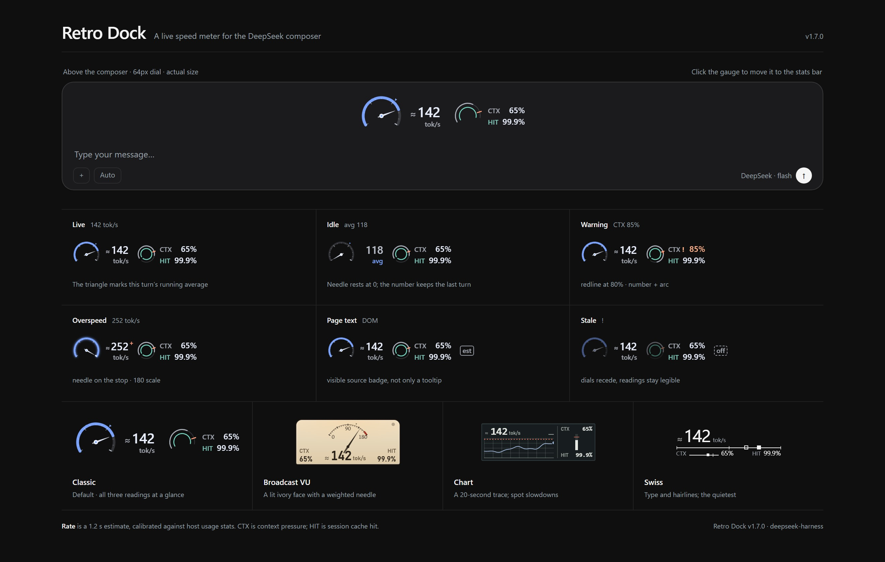

# DSH Retro Dock

A live speed meter for the DeepSeek Harness composer. While the model writes, a needle shows how fast it is going; once it stops, the number keeps the last turn's average. A smaller dial beside it shows context pressure and cache hit.



> [Light specimen](docs/classic-light-en.jpg) · [Settings · dark](docs/settings-dark-en.jpg) · [Settings · light](docs/settings-light-en.jpg) · [Measurement contract](MEASUREMENT.md) · [Changelog](CHANGELOG.md) · [中文](README.md)

## What you can read at a glance

- **Speed**: live tok/s as a needle and a number. Calibrated automatically against DeepSeek's own usage stats; `≈` marks it as an estimate.
- **Turn average**: a small triangle outside the scale marks the current turn's running average, so you can see whether the needle is above or below it. When generation stops, the number keeps the last turn's average and the unit reads `avg`. The needle still drops to zero.
- **Context**: the CTX outer ring. It stays neutral until the warning line (80% by default); past it, the overrun arc, the number and a `!` change colour together.
- **Cache hit**: the HIT inner ring, in teal. Its label is teal too, so it works as a legend.
- **Data quality**: if host stats are missing and the speed is estimated from page text, the gauge shows `est`. If data stops arriving, it shows a dashed `off`.

## Four looks

| Style | Mechanism | Best for |
| --- | --- | --- |
| **Classic** | 240° dual dial, tapered needle with counterweight | Default; all three readings at once |
| **Broadcast VU** | Ivory face, wide fan, over-range red zone | Long sessions |
| **Chart** | Twenty-second paper trace | Watching the trend and slowdowns |
| **Swiss** | Number, hairline rule, square cursor | The quietest option |

All four read the same data and calibration. Switch under **Settings → Retro Dock → Style**; the change applies immediately. Classic and VU can also show the speed on an odometer-style drum and add green / amber / red lamps beside CTX.

## Interaction

- **Click the gauge** to move it between above the composer and the stats bar. With the keyboard, Tab to it and press `Enter` / `Space`.
- **Hover** for a tooltip with speed, context, cache hit, the last turn (first-token latency, average speed, output), full scale, calibration factor and data source.
- **Density** follows the available width: full / compact / minimal. Minimal folds the gauge into one line; a CTX warning keeps its colour and `!`.
- **Theme** follows the host. Classic and Swiss borrow the host's ink; VU is a warm lit face that never darkens; Chart switches to dark paper in the dark theme.
- There is no gear or popover inside the gauge. All preferences live in the host's **Settings → Retro Dock**.

## Settings

Style, idle reading (keep the last turn's average), drum readout, context lamps, placement, density, full scale (120 / 180 / 240 / 300 tok/s), context warning line (70 / 80 / 90%), extra readings, and language. The panel on the right is a real preview rendered with your current settings.

A **Measurement** section shows the last turn's first-token latency, average speed and output, the calibration status with a reset, and a measurement-log export (timestamps and token counts only, no conversation text).

## Install

Confirm the profile first: `dsh web` uses the `web` profile; the desktop app uses `desktop`.

**DSH Web**

```bash
npx @deepseek-ai/dsh plugin --profile web add github:usermbzlj/dsh-retro-dock
```

**Desktop app**

```bash
cd ~/.dsh/profiles/desktop
pnpm add github:usermbzlj/dsh-retro-dock
```

After installing, check that `~/.dsh/profiles/<profile>/package.json` has `@local/retro-dock` in `dsh.profile.bundles`; add it manually if the CLI did not, then restart DSH.

**Local tarball**

```bash
npm pack   # local-retro-dock-1.7.0.tgz
```

## Data sources and measurement contract

Highest priority first:

1. Host projections: `contextPressure`, `tokenUsage`, `sessionStats`.
2. Chat store: `useChat(s => s.legacy.partial)`, counting model output fields only.
3. Page-text fallback: when projections are missing, the host's visible text is read; the gauge shows `est`, and the tooltip and aria name the source.

Speed is an **estimate plus calibration**, not a server-side per-chunk count: a 1.2 s sliding window, incremental stream counting, and calibration against host `sessionStats` token deltas with the factor bounded to 0.4–2.5. The turn average excludes gaps over 1.5 s, such as tool waits. Formulas and failure modes are in [MEASUREMENT.md](MEASUREMENT.md).

**Privacy**: no network requests, no credentials; one preference key (`dsh-retro-dock:prefs:v3`; the old v2 key and `rg-gauge-placement` migrate automatically). `window.__retroDock` is a debug mirror.

**Performance**: rAF stops when idle; no DOM observer while a chat stream is available; O(delta) counting; ResizeObserver density; only Chart records a 20 s trace at 4 Hz while selected, paused when the page is hidden.

## Compatibility

- Platform: web (Chromium).
- Host: `dsh >= 0.2.0-rc.1 < 0.3.0`; verified on `0.2.1-rc.3`.
- Known limits: without `sessionStats` there is no calibration; the page-text fallback is less trustworthy than host projections.

## Development

```bash
npm install
npm run build      # bundle src/ into client.js
npm test           # 71 tests
npm run preview    # build docs/gallery.html (specimen sheet and settings)
npm run shots      # needs Chromium: npx playwright install chromium
node review/states-shoot.mjs   # every look × placement × state, for visual review
```

`client.js` is a build artifact; do not edit it by hand. Source layout:

```
src/measure.js        pure measurement functions
src/stream.js         incremental stream counting
src/rate.js           1.2 s window, smoothing, calibration
src/engine.js         process-wide engine (including last-turn stats)
src/prefs.js          preference store and migrations
src/themes.js         preference validation
src/i18n.js           Chinese / English strings
src/ui/classic.js     classic dual dial
src/ui/design-gauge.js shared shell for VU / Chart / Swiss
src/ui/designs/       the three mechanisms plus shared parts (drum, lamps, minimal line)
src/ui/gauge.js       slot component and state wiring
src/ui/settings.js    host settings page
src/styles/           matching CSS
scripts/              build / gallery / shots
```

## Versions

- **1.7.0**: idle reading keeps the last turn's average, with a turn-average marker on the scale; classic dial gets a new needle, pivot and ticks, loses the stray dot at 0 tok/s, right-aligns its readout and glows when over range; CTX shows `%`; HIT's label doubles as a legend; lamps get solid lenses; settings greys out switches a look does not support; README and specimens now show the four looks.
- **1.6.x**: trimmed to four looks; VU scale and Swiss cursor fixes; larger gauges above the composer.
- **1.5.0**: last-turn readout; measurement-log export; conversation switches no longer skew calibration.
- **1.1.0**: the historical four-style release, kept as a tag and Release.

## License

MIT
