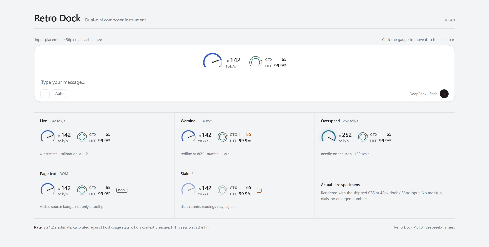

# DSH Retro Dock

A composer instrument for DeepSeek Harness: live tokens per second, context pressure and session cache hit. 1.4.0 keeps the classic dual dial and adds seven selectable measuring languages: Bench, Broadcast VU, Altimeter, Signal, Chart, Swiss and Compass. Pick one under **Settings → Retro Dock → Style**; the classic dual dial remains the default.




> [Seven instruments · design study](docs/seven-designs.md) · [Settings · dark](docs/settings-dark-en.jpg) · [Settings · light](docs/settings-light-en.jpg) · [Measurement contract](MEASUREMENT.md) · [Changelog](CHANGELOG.md) · [中文](README.md)

## Seven measuring languages

| Style | Mechanism | Best for |
| --- | --- | --- |
| **Bench** | 240° scale, knife needle, recessed CTX bar | Precision and quiet; works in light and dark |
| **Broadcast VU** | 130° fan, wedge needle, printed red zone | Long sessions; warm and physical |
| **Altimeter** | 270° needle, three-digit drum window | Digits first |
| **Signal** | Semaphore arm, three state lamps, counter | Seeing the warning state before the number |
| **Chart** | Twenty-second paper trace, pen dot, pressure bar | Watching the trend during long generations |
| **Swiss** | Number, hairline rule, square cursor | The quietest option: no machine, just a reading |
| **Compass** | Rotating card, brass bezel, fixed lubber line | An object that moves without asking for attention |

The classic dual dial is the eighth option and the default. All eight share one `vm`, one calibration path and one set of state flags (live / warn / over / stale / DOM); a style changes the mechanism, not the measurement. Each was checked at the real 56px composer slot and 42px stats bar, with full / compact / minimal densities.

The settings picker shows eight real 42px previews; the preview follows position, density, full scale, warning threshold and the sub-readout switch. Inside the host's 800px settings panel the page is a single-column form with a two-up preview; wide hosts keep the side preview. `npm run catalogue` generates the interactive catalogue at `docs/catalogue.html`; the written study is [docs/seven-designs.md](docs/seven-designs.md).

## Appearance

- **Classic main dial**: 240° scale, four ticks with a heavier end tick, tapered needle. Default full scale 180 tok/s, configurable to 120 / 240 / 300. Past full scale the needle rests at the stop, the ring turns cyan and the number keeps rising; the tooltip names the full scale.
- **Classic sub dial**: a 38px dual ring at full composer density. CTX is neutral below the threshold, with a redline printed at the threshold; past it the overrun arc, the number and `!` turn caution. HIT stays cyan so it never reads as a warning.
- **Seven styles**: Bench, VU, Altimeter, Signal, Chart, Swiss, Compass. Each has its own mechanism, surface, type and motion; red is reserved for limits. See the [design study](docs/seven-designs.md).
- **Placement**: click the instrument to move it between above-composer and the stats bar; hover/focus draws a quiet outline; the choice persists.
- **Density**: composer full / compact / minimal at 860 / 620; stats bar full / minimal at 560. Minimal folds the instrument into one line; a CTX warning keeps its colour and `!`.
- **Theme**: follows the host. Bench, Altimeter, Signal and Chart own dark surfaces in the dark theme; the VU stays a warm lit face; Swiss borrows the host's ink and paper completely; Compass only lets its readout follow the host — the card remains its own object.
- **Data quality**: page-text fallback shows a `DOM` badge; unavailable data shows `!`; the mechanism recedes while readings stay legible. Source and warning are in the aria-label and tooltip.
- No gear button or popover inside the instrument. Style and preferences live in the host settings section.

## Features

- **Rate**: live tok/s with `≈`. 1.2s sliding window, incremental stream counting, calibration against host `sessionStats` with a 0.4–2.5 multiplier. The `≈` has a fixed slot so live/idle never shifts the centred instrument.
- **CTX / HIT**: current context pressure and whole-session cache hit. HIT keeps the host's precision and never rounds a partial hit to 100%.
- **Styles**: eight options (classic plus seven measuring languages); 42px real previews in settings; switching applies immediately.
- **Settings**: style, placement, density, full scale, CTX warning, sub-readout switch, language, calibration reset. Full-page controls; the preview uses the current scale, warning line and placement, and labels example readings as examples.
- **Language**: Chinese / English / follow host; tooltip, aria and settings are bilingual.
- **Performance**: idle rAF stop; no DOM observer while a stream is active; O(delta) counting; ResizeObserver density; only the Chart style records a 20s trace at 4Hz while selected, paused when the page is hidden.
- **Privacy**: no network requests, no credentials; one preference key. `window.__retroDock` is a debug mirror.

## Install

Confirm the profile first: `dsh web` uses the `web` profile; the desktop app uses `desktop`.

**DSH Web**

```bash
npx @deepseek-ai/dsh plugin --profile web add github:usermbzlj/dsh-retro-dock
```

**Desktop app**

```bash
cd ~/.dsh/profiles/desktop
pnpm add github:usermbzlj/dsh-retro-dock
```

After installing, check that `~/.dsh/profiles/<profile>/package.json` has `@local/retro-dock` in `dsh.profile.bundles`; add it manually if the CLI did not, then restart DSH.

**Local tarball**

```bash
npm pack   # local-retro-dock-1.4.0.tgz
```

> The 1.1.0 four-style release remains available from the tag / Release. `main` is 1.4.0: classic plus seven measuring languages.

## Interaction

- Click the instrument to move it between the composer slot and the stats bar.
- Keyboard: Tab to the instrument, then `Enter` / `Space` to move it.
- Settings: **Settings → Retro Dock**; style, placement, density, full scale, CTX warning, sub-readouts, language and calibration. No gear or popover in the gauge.
- Preference key: `dsh-retro-dock:prefs:v3`; `v2` is migrated and removed. Retired 1.1.0 style values (`neon` / `minimal` / `terminal`) are not new ids and normalise back to `classic`; the old `rg-gauge-placement` key still migrates.
- Old 1.1.0 style values do not silently become a new language; this is deliberate — they have no one-to-one successor.

## Data sources and measurement contract

Highest priority first:

1. Host projections: `contextPressure`, `tokenUsage`, `sessionStats`.
2. Chat store: `useChat(s => s.legacy.partial)`, counting model output fields only.
3. Page-text fallback: when projections are missing, read visible host text; the instrument shows a `DOM` badge and the tooltip/aria name the source.

Rate is an **estimate plus calibration**, not server-side per-chunk token counting. The tooltip shows the calibration factor/samples, full scale, warning line and source; settings show calibration state. The full formula and failure conditions are in [MEASUREMENT.md](MEASUREMENT.md).

All seven languages read the same data. The Chart trace only records samples after it mounts; it never invents the left half of the paper.

## Compatibility

- Platform: web (Chromium).
- Host: `dsh >= 0.2.0-rc.1 < 0.3.0`; currently verified on `0.2.1-rc.3`.
- Theme: follows `[data-ds-dark-theme]` and host tokens; light and dark both work.
- Known limits: calibration is unavailable without `sessionStats`; page-text fallback is less trustworthy than host projections; live precision still needs a real session trace. The live feel of the seven new styles also needs a real stream.

## Development

```bash
npm install
npm run build      # src/ -> client.js
npm test           # 59 tests
npm run preview    # docs/gallery.html (classic specimens + settings)
npm run catalogue  # docs/catalogue.html (seven-language catalogue)
npm run shots      # needs Chromium: npx playwright install chromium
npm run catalogue:shots  # also writes docs/seven-languages*.jpg (only the hero ships)
```

`client.js` is a build artifact; do not edit it by hand. Source layout:

```
src/measure.js        pure measurement helpers
src/stream.js         incremental stream counting
src/rate.js           1.2s window, smoothing, calibration
src/engine.js         process-level engine
src/prefs.js          preference store, v3/v2/legacy migration
src/themes.js         style, density, scale and warning validation
src/designs/meta.js   metadata for the seven languages
src/i18n.js           Chinese/English strings
src/ui/classic.js     classic dual dial
src/ui/design-gauge.js shared shell for the seven (semantics, states, minimal line)
src/ui/designs/       the seven mechanisms: bench / vu / altimeter / signal / chart / swiss / compass
src/ui/gauge.js       slot component and state wiring
src/ui/settings.js    host settings page with the style picker
src/styles/classic.js
src/styles/designs/   seven styles + shared shell CSS
src/styles/settings.js
scripts/              build / gallery / catalogue / shots
```

Tests cover pure measurement, incremental counting, window/calibration, preference migration (v3/v2, retired style fallback, old key), i18n, classic SSR / warning / source / preview states, SSR of all seven mechanisms, the settings preview, jsdom mount/stream/style switch/placement, and the built bundle's ModuleLoader contract. CI runs `npm ci`, rebuilds, verifies `client.js` and runs the tests.

## Verification

- Automation: 59/59 pass; the classic gauge, all seven new mechanisms and the settings style picker render in Chromium.
- Catalogue: `docs/catalogue.html` renders at 1440px with 91 real 1× instrument instances; light/dark hosts, six states, 2× craft details and a minimal-density comparison are in the page.
- Contrast: primary and secondary text is ≥4.5:1; arcs, needles, lamps and limit marks are ≥3:1. The light Signal amber was deepened to 4.3:1; the light Altimeter limit red to 5.0:1.
- Real host: no real-session trace yet. After a refresh/restart the tooltip should say `数据源 宿主统计`; if it says `页面文本` or stays on "waiting for host stats", please report the tooltip text and host version.
- Live feel of the seven new styles (needle damping, drum roll, compass card, chart stepping) has not been individually verified in a real stream; static 1× and 2× are verified.

## Versions

- **1.4.0**: seven selectable measuring languages (Bench, VU, Altimeter, Signal, Chart, Swiss, Compass) plus the classic dual dial; style picker in settings; `prefs:v3` with v2 migration; shared shell, states and minimal line; design study and catalogue.
- **1.3.0**: theme-aware classic dial (light readable), CTX redline, minimal warning, visible source/stale states, fixed `≈` slot, full-page settings with truthful previews, new README specimens; removed the 1.1.0 layer and `style` preference.
- **1.2.0**: restored the pre-1.1.0 classic dual dial as the only gauge, keeping measurement/calibration/performance and the settings data layer.
- **1.1.0**: four-style release, preserved in the tag and Release for reference.

## License

MIT
