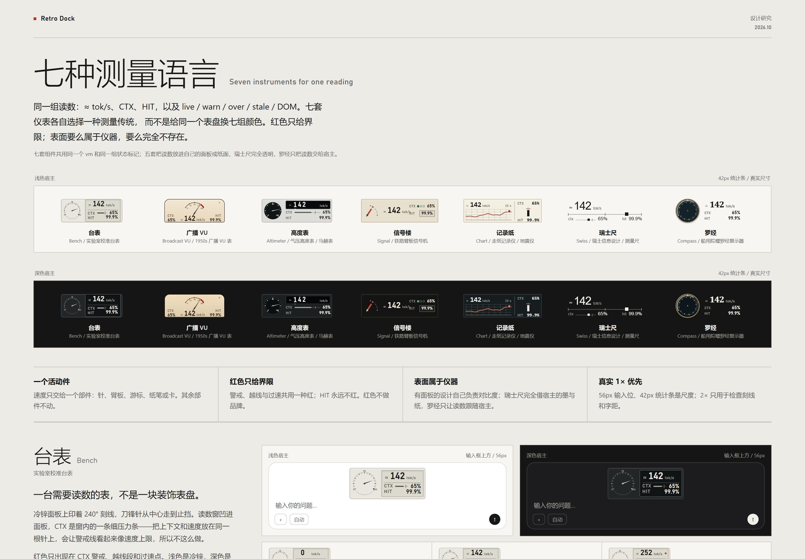
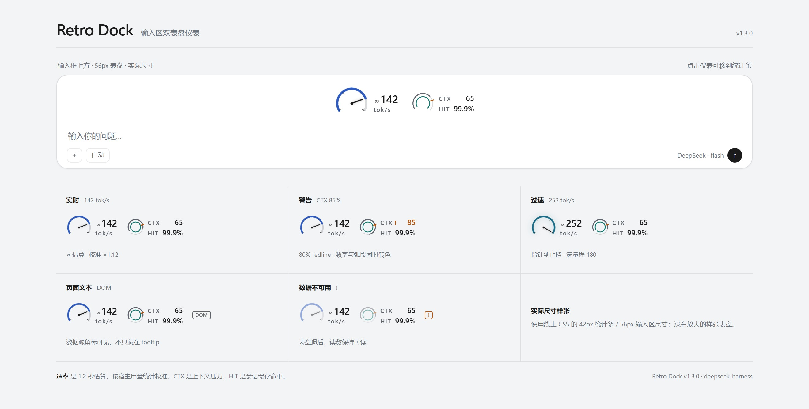

# DSH Retro Dock

DeepSeek Harness 输入区仪表：实时生成速度、上下文占用与会话缓存命中。保留经典双表盘，并提供七种可选的测量语言——台表、广播 VU、高度表、信号楼、记录纸、瑞士尺、罗经。样式在宿主「设置 → Retro Dock → 样式」里切换，默认仍是经典双表盘。1.5.0 新增「最近一轮」读数（首 token 延迟、平均速度、输出量）和测量日志导出。






> [七种测量语言 · 设计研究](docs/seven-designs.md) · [设置页 · 深色](docs/settings-dark.jpg) · [设置页 · 浅色](docs/settings-light.jpg) · [测量契约](MEASUREMENT.md) · [更新记录](CHANGELOG.md) · [English](README.en.md)

## 七种测量语言

| 样式 | 机构 | 适合 |
| --- | --- | --- |
| **台表** Bench | 240° 刻线、刀锋针、凹窗压力条 | 精确、安静；浅色也成立，最接近经典 |
| **广播 VU** | 130° 扇区、楔形针、印刷红区 | 长时间陪伴；暖色、有质量 |
| **高度表** Altimeter | 270° 细针、三位鼓窗 | 数字优先；只想知道“多少” |
| **信号楼** Signal | 臂板、三枚状态灯、机械计数器 | 先看清是否到警戒，再读具体值 |
| **记录纸** Chart | 20 秒走纸、笔点、压力条 | 长生成时用余光看走势与掉速 |
| **瑞士尺** Swiss | 数字、发丝标尺、方块游标 | 最安静；不要机器，只要一条读数 |
| **罗经** Compass | 旋转罗经卡、黄铜圈、固定基准线 | 想要一个会动、但不抢注意力的对象 |

经典双表盘保留为第 8 个选项，也是默认值。七套新样式共用同一组 `vm`、同一套校准与同一组状态标记（live / warn / over / stale / DOM）；样式只改测量机构，不改测量口径。每套都在 56px 输入位与 42px 统计条上验收，并各自支持 full / compact / minimal。

设置页的样式选择器用 42px 的真实预览展示 8 个选项；预览跟随当前位置、密度、满量程、警戒线与副表开关。宿主 800px 设置面板内是单列表单 + 两列预览，宽宿主仍保留右侧预览。交互式目录用 `npm run catalogue` 生成到 `docs/catalogue.html`，设计说明见 [七种测量语言](docs/seven-designs.md)。

## 外观

- **经典主表**：240° 量程，0 / 60 / 120 / 180 四个刻度，末端刻度加粗；锥形指针。默认 0–180 tok/s，可调 120 / 240 / 300。超过满量程后指针停在止挡，环进入青色过速辉光，数字继续上升；tooltip 会标出满量程。
- **经典副表**：输入区完整密度为 38px 双环。CTX 在阈值以下是中性色，阈值处有一条 redline；越过阈值后弧段、数字和 `!` 同时转为警示色。HIT 保持青色，与 CTX 分开。
- **七套样式**：台表、VU、高度表、信号楼、记录纸、瑞士尺、罗经。每套有自己的机构、表面、字体与运动；红色只用于界限。详细设计见 [设计研究](docs/seven-designs.md)。
- **位置**：点击仪表在「输入框上方」和「底部统计条」之间切换；hover / focus 有轻描边提示，选择持久化。
- **密度**：输入位按宽度切换 full / compact / minimal（860 / 620）；统计条只有 full / minimal（560）。minimal 把仪表折成一行读数，警告时 CTX 项变橙并带 `!`。
- **主题**：仪表跟随宿主明暗主题。台表、高度表、信号楼、记录纸在深色下拥有自己的深色表面；VU 在深色下是一块暖色的亮表；瑞士尺完全借宿主的墨与纸；罗经只让读数跟随宿主，卡仍是自己的对象。
- **数据质量**：页面文本回退显示 `DOM` 角标；数据不可用时显示 `!` 角标，表盘退后、读数保持可读。aria-label 与 tooltip 都写明数据源。
- 仪表本身没有齿轮按钮或弹层。样式与偏好集中到宿主「设置 → Retro Dock」。

## 功能

- **主表**：实时 tok/s，读数带 `≈`。1.2 秒滑动窗口；流式内容增量计数；校准用宿主 `sessionStats` 的 token 增量，倍率限幅 0.4–2.5。`≈` 有固定槽位，live / idle 切换不会让居中仪表横移。
- **副表**：CTX = 当前上下文占用；HIT = 全会话缓存命中。HIT 的精度与宿主统计条一致，不把部分命中舍成 100%。
- **样式**：8 个选项（经典 + 七种测量语言）；设置页用 42px 真实预览；选中立即生效，不必刷新。
- **设置**：样式、位置、密度、满量程、CTX 警告阈值、副表开关、语言、重置校准。全页尺度控件；预览使用当前满量程、警戒线和停靠位置，示例读数明确标注为“示例”。
- **最近一轮**：首 token 延迟（宿主提供运行状态时）、去掉工具等待后的平均速度、输出 token 数；显示在 tooltip 和设置页。
- **测量日志**：设置页「导出测量日志」下载一个 JSON，只含时间戳、token 计数、宿主统计与校准样本，不含对话内容；用于离线复盘校准。
- **语言**：中文 / English / 跟随宿主；tooltip、aria、设置页双语。
- **性能**：空闲停 rAF；有聊天流时不挂 DOM observer；流式计数 O(delta)；密度用 ResizeObserver；只有记录纸样式在选中时以 4Hz 记录 20 秒轨迹，页面隐藏时暂停采样。
- **隐私**：不发网络请求、不读凭据；只持久化一个偏好 key。`window.__retroDock` 是调试镜像。

## 安装

先确认 profile：`dsh web` 使用 `web` profile，桌面应用使用 `desktop` profile。

**DSH Web**

```bash
npx @deepseek-ai/dsh plugin --profile web add github:usermbzlj/dsh-retro-dock
```

**桌面应用**

```bash
cd ~/.dsh/profiles/desktop
pnpm add github:usermbzlj/dsh-retro-dock
```

安装后确认 `~/.dsh/profiles/<profile>/package.json` 的 `dsh.profile.bundles` 包含 `@local/retro-dock`；若 CLI 没自动写入，手动加进数组，再重启 DSH。

**本地打包**

```bash
npm pack   # local-retro-dock-1.5.0.tgz
```

> 1.1.0 的四套样式版本仍保留在 tag / Release 里；当前 `main` 是 1.4.0：经典 + 七种测量语言。

## 交互

- 点击仪表：在输入位和统计条之间切换。
- 键盘：Tab 到仪表后 `Enter` / `Space` 切换位置。
- 设置：宿主「设置 → Retro Dock」；样式、位置、密度、满量程、CTX 警告、副表、语言、校准都在这里。没有 gauge 内齿轮或弹层。
- 偏好 key：`dsh-retro-dock:prefs:v3`；`v2` 会自动迁移并删除。1.1.0 的 `neon` / `minimal` / `terminal` 等旧 style 值不属于新 id，归一化时会回落到 `classic`；旧 key `rg-gauge-placement` 仍会自动迁移。
- 旧的 1.1.0 style 值不会静默变成某个新样式——这是有意的：旧值与新机构没有一一对应关系。

## 数据来源与测量契约

优先级从高到低：

1. 宿主投影：`contextPressure`、`tokenUsage`、`sessionStats`。
2. 聊天 store：`useChat(s => s.legacy.partial)`，只统计模型输出字段。
3. 页面文本回退：投影缺失时读取宿主可见文本；仪表显示 `DOM` 角标，tooltip 与 aria 写明数据源。

速度是**估算 + 校准**，不是服务端逐 chunk token 计数。tooltip 会显示校准倍率/样本、满量程、警戒线和数据源；设置页显示校准状态。完整公式与失效条件见 [MEASUREMENT.md](MEASUREMENT.md)。

七套样式读同一组数据，不各自发明读数。记录纸的轨迹只记录挂载后的样本；没有历史时不伪造左半张纸。

## 兼容

- 平台：web（Chromium 内核）。
- 宿主：`dsh >= 0.2.0-rc.1 < 0.3.0`；当前在 `0.2.1-rc.3` 上验证。
- 主题：仪表跟随 `[data-ds-dark-theme]` 与宿主 token；浅色/深色都可用。
- 已知限制：`sessionStats` 缺失时校准不可用；页面文本回退不如宿主投影可信；实时值仍需要一次真实会话 trace 才能宣称测量精度。七套新样式的真实会话观感也仍待验收。

## 开发

```bash
npm install
npm run build      # 把 src/ 打包成 client.js
npm test           # 63 项测试
npm run preview    # 生成 docs/gallery.html（经典样张与设置页）
npm run catalogue  # 生成 docs/catalogue.html（七种测量语言目录）
npm run shots      # 需要 Chromium：npx playwright install chromium
npm run catalogue:shots  # 同上，生成 docs/seven-languages*.jpg（只有 hero 图随包发布）
```

`client.js` 是构建产物，不要手改。源码结构：

```
src/measure.js        纯测量函数
src/stream.js         增量流式计数
src/rate.js           1.2s 窗口、平滑、校准
src/engine.js         进程级引擎
src/prefs.js          偏好存储与 v3/v2/旧 key 迁移
src/themes.js         样式、密度、量程等偏好校验
src/designs/meta.js   七种测量语言的元数据
src/i18n.js           中英文字符串
src/ui/classic.js     经典双表盘
src/ui/design-gauge.js 七套样式的 shell（语义、状态、最小读数行）
src/ui/designs/       七套机构：bench / vu / altimeter / signal / chart / swiss / compass
src/ui/gauge.js       槽位组件与状态接线
src/ui/settings.js    宿主设置页（含样式选择器）
src/styles/classic.js
src/styles/designs/   七套样式 CSS + 共享 shell
src/styles/settings.js
scripts/              build / gallery / catalogue / shots
```

测试覆盖：纯测量、增量计数、窗口/校准、偏好迁移（v3/v2、旧 style 回落、旧 key）、i18n、经典仪表 SSR / 警告 / 数据源 / 预览状态、七套新机构 SSR、设置预览、jsdom 挂载/流式/切换样式/位置切换、构建产物的 ModuleLoader 契约。CI 在 `.github/workflows/ci.yml` 中执行 `npm ci`、重新构建、校验 `client.js`、跑测试。

## 验证状态

- 自动化：63/63 通过；经典仪表、七套新机构、设置页样式选择器都在 Chromium 中渲染并截图。
- 目录页：`docs/catalogue.html` 在 Chromium 中按 1440px 渲染，共 91 个真实 1× 仪表实例；浅/深双语料、六种状态、2× 工艺细节与 minimal 密度对照都在页面里。
- 对比度：深层墨/浅层墨文字均 ≥4.5:1；承担读数的弧、针、灯与红区 ≥3:1；浅色信号楼的琥珀灯已加深到 4.3:1，浅色高度表的界限红改为 5.0:1。
- 宿主实机：尚未采集真实会话 trace。刷新/重启后 tooltip 应显示 `数据源 宿主统计`；如果显示 `页面文本` 或长期“等待宿主统计”，请反馈 tooltip 文案和宿主版本。
- 七套新样式的**动效观感**（针的阻尼、鼓轮、罗经卡旋转、走纸步进）尚未在真实流中逐套验收；静态 1× 与 2× 已验收。

## 版本说明

- **1.5.0**：最近一轮读数（首 token、平均速度、输出量）；测量日志导出；会话切换不再污染校准；CTX 未知时信号楼不亮灯；七套样式补齐 macOS / Linux 回落字体。
- **1.4.0**：七种可选测量语言（台表、VU、高度表、信号楼、记录纸、瑞士尺、罗经）+ 经典双表盘；设置页样式选择器；`prefs:v3` 与 v2 迁移；共用 shell、状态与最小读数行；七种语言的设计研究与目录页。
- **1.3.0**：主题化仪表（浅色可读）、CTX 阈值 redline、minimal 警告、数据源/陈旧状态的可见标记、固定 `≈` 槽位、全页设置页与真实预览、README 样张表；清理 1.1.0 遗留样式/组件和 `style` 偏好。
- **1.2.0**：恢复 1.1.0 之前的经典双表盘视觉，保留测量/校准/性能与设置数据层。
- **1.1.0**：四套样式版本，tag 与 Release 保留，作为历史版本可访问。

## 许可

MIT
