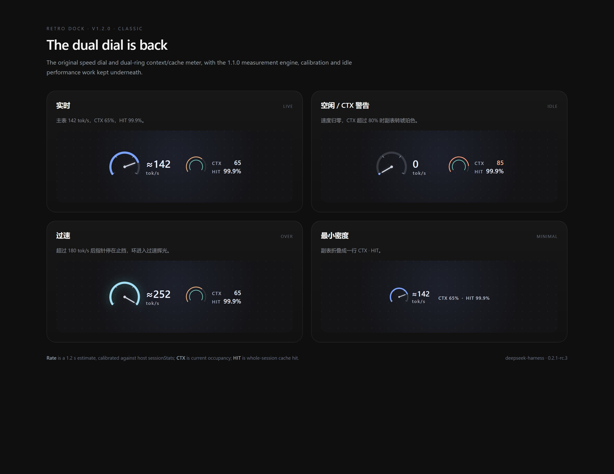

# DSH Retro Dock

DeepSeek Harness 输入区双表盘仪表：主表显示实时生成速度，副表显示上下文占用与会话缓存命中。视觉回到 1.1.0 之前的经典外观；底下保留 1.1.0 的测量引擎、校准与空闲性能。



> [设置面板](docs/settings-dark.jpg) · [测量契约](MEASUREMENT.md) · [更新记录](CHANGELOG.md) · [English](README.en.md)

## 外观

- **主表**：240° 量程，0 / 60 / 120 / 180 四个刻度，锥形指针；默认 0–180 tok/s，可调 120 / 240 / 300。超过满量程后指针停在止挡，环进入青色过速辉光，数字继续上升。
- **副表**：38px 双环，琥珀色 CTX、青色 HIT；右侧两行读数。CTX 达到阈值（默认 80%）时转橙色。
- **位置**：点击仪表在「输入框上方」和「底部统计条」之间切换；选择持久化。
- **密度**：输入位按宽度切换 full / compact / minimal（原阈值 860 / 620）；统计条只有 full / minimal（560）。minimal 把副表折叠成一行 `CTX · HIT`。
- **主题**：经典仪表是深色外观；设置面板跟随宿主的明暗主题。
- 没有四套样式切换，也没有齿轮按钮。偏好集中到宿主「设置 → Retro Dock」。

## 功能

- **主表**：实时 tok/s，读数带 `≈`。1.2 秒滑动窗口；流式内容增量计数；校准用宿主 `sessionStats` 的 token 增量，倍率限幅 0.4–2.5。
- **副表**：CTX = 当前上下文占用；HIT = 全会话缓存命中。HIT 的精度与宿主统计条一致，不把部分命中舍成 100%。
- **设置**：位置、密度、满量程、CTX 警告阈值、副表开关、语言、重置校准；没有 gauge 内弹层，统一在宿主设置页。
- **语言**：中文 / English / 跟随宿主；tooltip、aria、设置页双语。
- **性能**：空闲停 rAF；有聊天流时不挂 DOM observer；流式计数 O(delta)；密度用 ResizeObserver。
- **隐私**：不发网络请求、不读凭据；只持久化一个偏好 key。`window.__retroDock` 是调试镜像。

## 安装

先确认 profile：`dsh web` 使用 `web` profile，桌面应用使用 `desktop` profile。

**DSH Web**

```bash
npx @deepseek-ai/dsh plugin --profile web add github:usermbzlj/dsh-retro-dock
```

**桌面应用**

```bash
cd ~/.dsh/profiles/desktop
pnpm add github:usermbzlj/dsh-retro-dock
```

安装后确认 `~/.dsh/profiles/<profile>/package.json` 的 `dsh.profile.bundles` 包含 `@local/retro-dock`；若 CLI 没自动写入，手动加进数组，再重启 DSH。

**本地打包**

```bash
npm pack   # local-retro-dock-1.2.0.tgz
```

> 1.1.0 的四套样式版本仍保留在 tag / Release 里，但当前 GitHub main 是 1.2.0 经典双表盘。

## 交互

- 点击仪表：在输入位和统计条之间切换。
- 键盘：Tab 到仪表后 `Enter` / `Space` 切换位置。
- 设置：宿主「设置 → Retro Dock」。经典版不提供 gauge 内齿轮。
- 偏好 key：`dsh-retro-dock:prefs:v2`；旧的 `rg-gauge-placement` 会自动迁移并删除。

## 数据来源与测量契约

优先级从高到低：

1. 宿主投影：`contextPressure`、`tokenUsage`、`sessionStats`。
2. 聊天 store：`useChat(s => s.legacy.partial)`，只统计模型输出字段。
3. DOM 回退：投影缺失时读取宿主可见文本；tooltip 标出 `数据源 DOM 回退`。

速度是**估算 + 校准**，不是服务端逐 chunk token 计数。tooltip 会显示 `校准 ×1.12 · 7 样本`、`未校准`、`校准待统计` 或 `校准不可用`。完整公式与失效条件见 [MEASUREMENT.md](MEASUREMENT.md)。

## 兼容

- 平台：web（Chromium 内核）。
- 宿主：`dsh >= 0.2.0-rc.1 < 0.3.0`；当前在 `0.2.1-rc.3` 上验证。
- 经典仪表为深色；设置页跟随宿主 `body[data-ds-dark-theme]`。
- 已知限制：`sessionStats` 缺失时校准不可用；DOM 回退不如投影可信；实时值仍需要一次真实会话 trace 才能宣称测量精度。

## 开发

```bash
npm install
npm run build      # 把 src/ 打包成 client.js
npm test           # 44 项测试
npm run preview    # 生成 docs/gallery.html 经典仪表画廊
npm run shots      # 需要 Chromium：npx playwright install chromium
```

`client.js` 是构建产物，不要手改。源码结构：

```
src/measure.js      纯测量函数
src/stream.js       增量流式计数
src/rate.js         1.2s 窗口、平滑、校准
src/engine.js       进程级引擎
src/prefs.js        偏好存储与旧 key 迁移
src/i18n.js         中英文字符串
src/ui/classic.js   经典双表盘视图
src/ui/gauge.js     槽位组件与状态接线
src/ui/settings.js  宿主设置页
src/styles/classic.js / settings.js
scripts/            build / gallery / screenshots
```

测试覆盖：纯测量、增量计数、窗口/校准、偏好迁移、i18n、经典仪表 SSR、jsdom 挂载/流式/位置切换、构建产物的 ModuleLoader 契约。CI 在 `.github/workflows/ci.yml` 中执行 `npm ci`、重新构建、校验 `client.js`、跑测试。

## 验证状态

- 自动化：44/44 通过；经典仪表和设置页已在 Chromium 中渲染并截图（`docs/classic-dark.jpg`、`docs/settings-dark.jpg`）。
- 宿主实机：尚未采集真实会话 trace。刷新/重启后 tooltip 应显示 `数据源 投影` 和实际校准倍率；如果显示 `DOM 回退` 或长期 `校准待统计`，请反馈 tooltip 文案和宿主版本。

## 版本说明

- **1.2.0**：恢复 1.1.0 之前的经典双表盘视觉，保留测量/校准/性能与设置数据层。
- **1.1.0**：四套样式版本，tag 与 Release 保留，作为历史版本可访问。

## 许可

MIT
