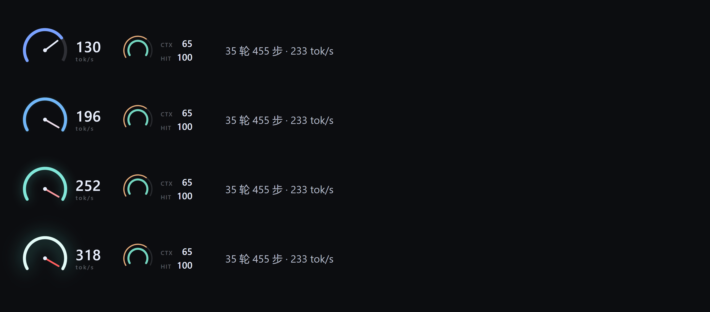

# DSH Retro Dock

DeepSeek Harness 输入区仪表盘插件：把「实时生成速度 / 上下文占用 / 缓存命中」做成一小组仪表，可常驻在输入框上方，也可停靠在底部统计条。



## 下载与安装

**方式一：直接下载 tarball**

[v1.0.0 tarball](https://github.com/usermbzlj/dsh-retro-dock/releases/download/v1.0.0/local-retro-dock-1.0.0.tgz)

**方式二：从 GitHub 安装**

```bash
pnpm add github:usermbzlj/dsh-retro-dock
```

**方式三：克隆后用本地路径**

```bash
git clone https://github.com/usermbzlj/dsh-retro-dock.git
pnpm add file:./dsh-retro-dock
```

装好后在 DSH profile 的 `dsh.profile.bundles` 里加入包名，重启 DSH：

```jsonc
// ~/.dsh/profiles/desktop/package.json
{
  "dsh": {
    "profile": {
      "bundles": ["@local/retro-dock"]
    }
  }
}
```

`cordis.patch.yml` 负责把插件插入 host 面；`client.js` 是 Web 渲染半边，通过 `window.__ModuleLoader__.load` 加载。

## 功能

- **主表**：实时 tok/s。240° 量程（0–180），指针与弧同源、二阶弹簧阻尼；超过满量程后指针在止挡附近轻微颤动，环由蓝变青并逐渐提亮。
- **副表**：双环。外环琥珀色 = 上下文占用（CTX），内环青色 = 缓存命中率（HIT），右侧两行读数。
- **位置可切换**：点一下仪表即可在「输入框上方」和「底部统计条」之间切换，选择保存在 `localStorage('rg-gauge-placement')`，重启后保持。
- **密度自适应**：按仪表父容器的实际宽度切换 full / compact / minimal 三档；minimal 档把副表折叠成一行 `CTX · HIT` 文字，不挤占宿主统计条。
- **不覆盖宿主样式**：全部元素使用自有类名（`.rg-*`），只隐藏了宿主活动胶囊的前导图标这一处。

## 数据来源

- **实时速度**：优先读聊天 store 的流式内容（`useChat(s => s.legacy.partial)`），按字符类型加权估算 token；宿主没提供 `useChat` 时退回 DOM 增量观察。
- **校准**：读 `sessionStats` 投影的 `decodeTokens / decodeMs`，与自身估算的会话均值比较，得到校准因子（限幅 0.4–2.5），让实时值长期收敛到真实平均。
- **CTX / HIT**：从宿主统计条的 DOM 文本读取。

实时值是估算 + 校准，不等于服务端的逐 chunk token 计数——那个数据在客户端的投影里拿不到。

## 兼容

- 平台：web
- 依赖：`@deepseek-ai/dsh-client-ui-conversation`
- 深色界面（宿主默认主题），不在浅色主题下测试过。

## 许可

MIT
