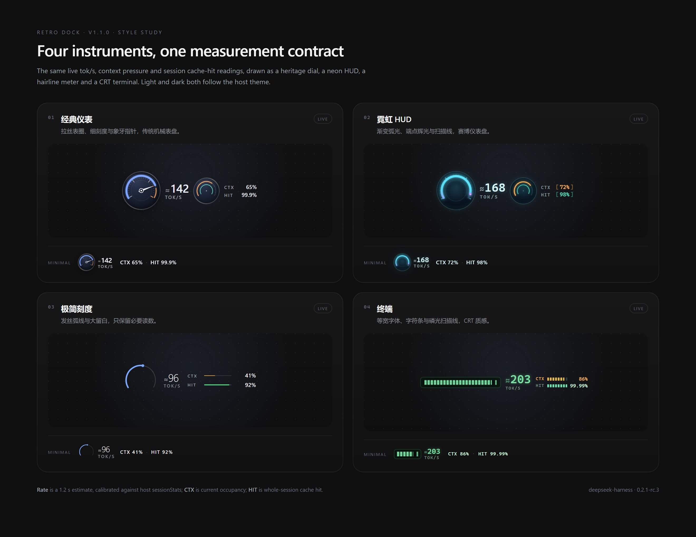

# DSH Retro Dock

DeepSeek Harness 输入区仪表盘：实时生成速度、上下文占用与会话缓存命中，四种仪表样式，跟随宿主明暗主题，可停靠在输入框上方或底部统计条。



> [浅色版本](docs/styles-light.jpg) · [设置面板](docs/settings-dark.jpg) · [测量契约](MEASUREMENT.md) · [更新记录](CHANGELOG.md) · [English](README.en.md)

## 四种样式

| 样式 | 气质 | 说明 |
| --- | --- | --- |
| **经典仪表** | 拉丝表圈、细刻度、红区与象牙指针 | 传统机械表盘；主表 240°、副表双环，适合常驻输入区。 |
| **霓虹 HUD** | 渐变弧光、端点辉光、扫描线 | 赛博仪表盘；等宽读数与方括号口径，适合深色主题。 |
| **极简刻度** | 发丝弧线、单端点、大留白 | 只保留必要信息；CTX/HIT 用细线表达，适合低干扰场景。 |
| **终端** | 等宽字体、字符条、磷光扫描线 | CRT 质感；主速度用分段条，CTX/HIT 用短条，浅色下是纸绿终端。 |

切换样式不会改变测量口径：四种样式读同一组投影、同一套校准和同一份停靠偏好。

## 功能

- **主表**：实时 tok/s，读数带 `≈`。1.2 秒滑动窗口；满量程可选 120 / 180 / 240 / 300；超过满量程后指针停在止挡、环进入过速辉光，读数仍继续上升。
- **副表**：CTX = 当前上下文占用；HIT = 全会话缓存命中。CTX 警告阈值可选 70 / 80 / 90；HIT 的精度与宿主统计条一致，不会把 99.94% 舍成 100%。
- **位置**：点一下仪表在「输入框上方」和「底部统计条」之间切换；设置面板里也能改。选择持久化到 localStorage。
- **密度**：按父容器宽度自动切换 full / compact / minimal；minimal 会把副表折叠成一行 `CTX · HIT`。也可在设置里锁定密度。
- **设置**：仪表右上角齿轮打开锚定弹层；宿主「设置 → Retro Dock」提供完整页面。可改样式、位置、密度、满量程、警告阈值、副表开关、语言，并可重置校准。
- **语言**：中文 / English / 跟随宿主；样式名、描述、tooltip、aria、设置页均有双语。
- **主题**：完全跟随宿主的明暗主题（`body[data-ds-dark-theme]`），不额外引入主题开关。
- **性能**：空闲时停止 rAF；有聊天流时不挂 DOM MutationObserver；流式计数只数新增片段；布局用 ResizeObserver，不再逐帧轮询。
- **隐私**：不发网络请求、不读凭据；只持久化一个偏好 key。调试镜像 `window.__retroDock` 暴露引擎状态，便于排查数据源。

## 安装

先确认要装进哪个 profile：`dsh web` 使用 `web` profile，桌面应用使用 `desktop` profile。两者不是同一个目录。

**DSH Web（`dsh web`）**

```bash
npx @deepseek-ai/dsh plugin --profile web add github:usermbzlj/dsh-retro-dock
```

**桌面应用**

在「设置 → 插件」中安装，或使用内置命令运行时。也可以直接改 profile：

```bash
cd ~/.dsh/profiles/desktop
pnpm add github:usermbzlj/dsh-retro-dock
```

安装后确认 `~/.dsh/profiles/<profile>/package.json` 的 `dsh.profile.bundles` 包含 `@local/retro-dock`；若 CLI 没有自动写入，手动加进数组，再重启 DSH。

**本地打包**

```bash
npm pack
# 得到 local-retro-dock-1.1.0.tgz
```

也可以直接下载 [v1.1.0 Release tarball](https://github.com/usermbzlj/dsh-retro-dock/releases/download/v1.1.0/local-retro-dock-1.1.0.tgz)。

把 tarball 装进 profile，或直接把本目录 link 进去（开发时推荐）：

```bash
cd ~/.dsh/profiles/desktop
pnpm add link:/path/to/retro-dock
```

安装后需要刷新页面或重启桌面应用；client 插件在启动/加载时读取。

## 交互

- 点击仪表：在输入位和统计条之间切换。
- 点击右上角齿轮：打开设置弹层；`Esc` 关闭，点击外部关闭，焦点回到齿轮。
- 键盘：Tab 到仪表后 `Enter` / `Space` 切换位置；齿轮按钮有独立标签。
- 宿主设置页：`设置 → Retro Dock`，与弹层共享同一份偏好。
- 偏好 key：`dsh-retro-dock:prefs:v2`；旧的 `rg-gauge-placement` 会自动迁移并删除。

## 数据来源与测量契约

优先级从高到低：

1. 宿主投影：`contextPressure`、`tokenUsage`、`sessionStats`。
2. 聊天 store：`useChat(s => s.legacy.partial)`，只统计模型输出字段。
3. DOM 回退：投影缺失时读取宿主可见文本；tooltip 会标出 `数据源 DOM 回退`。

速度是**估算 + 校准**，不是服务端逐 chunk token 计数。校准用宿主 `sessionStats` 的 token 增量与插件估计增量比较，倍率限幅 0.4–2.5 并做平滑；tooltip 会显示 `校准 ×1.12 · 7 样本`，没有样本时显示 `未校准`，宿主没有提供统计时显示 `校准不可用`。完整公式、失效条件、精度与验证方式见 [MEASUREMENT.md](MEASUREMENT.md)。

## 兼容

- 平台：web（Chromium 内核）。
- 宿主：`dsh >= 0.2.0-rc.1 < 0.3.0`；当前在 `0.2.1-rc.3` 上开发和验证。
- 依赖：`@deepseek-ai/dsh-client-ui-conversation`（client inject），已在 `package.json` 声明 peer 范围。
- 明暗主题：跟随宿主 `body[data-ds-dark-theme]`；浅色和深色都有独立配色。
- 已知限制：`sessionStats` 缺失时校准不可用；DOM 回退不如投影可信；实时值仍需要一次真实会话 trace 才能宣称测量精度。

## 开发

```bash
npm install
npm run build      # 把 src/ 打包成 client.js（宿主实际加载的文件）
npm test           # 43 项测试
npm run preview    # 生成 docs/gallery.html 样式画廊
npm run shots      # 需要 Chromium：npx playwright install chromium
```

`client.js` 是构建产物，不要手改。源码结构：

```
src/measure.js      纯测量函数（token 权重、CTX/HIT、格式化）
src/stream.js       增量流式计数
src/rate.js         1.2s 窗口、平滑、校准
src/engine.js       进程级引擎：流/统计/校准状态/订阅
src/prefs.js        偏好存储与旧 key 迁移
src/i18n.js         中英文字符串与语言解析
src/themes.js       样式元数据与偏好校验
src/ui/             视图、四种仪表、设置页、hook
src/styles/         基础布局与四套样式 CSS
scripts/build.mjs   esbuild 打包
scripts/gallery.mjs 样式画廊构建
scripts/shots.mjs   Playwright 截图
```

测试覆盖：纯测量、增量计数、窗口/校准、偏好迁移、i18n、四种样式的 SSR 渲染、jsdom 集成（挂载/切换/设置弹层/持久化）、构建产物的 ModuleLoader 契约。CI 在 `.github/workflows/ci.yml` 中执行 `npm ci`、重新构建、校验 `client.js` 未过期，然后跑测试。

## 验证状态

- 自动化：43/43 通过；四种样式与设置页已在 Chromium 中渲染并截图（见 `docs/`）。
- 宿主实机：尚未采集一次真实会话 trace。刷新/重启后，tooltip 应显示 `数据源 投影` 和实际校准倍率；如果显示 `DOM 回退` 或 `校准不可用`，请把 tooltip 文案和宿主版本反馈过来。
- 已知待办：`sessionStats` 缺失时的降级路径、极窄容器下的密度阈值、更多真实会话的校准统计，都还需要实机样本。

## 许可

MIT
